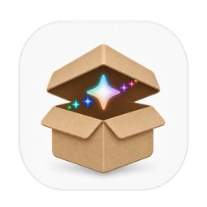
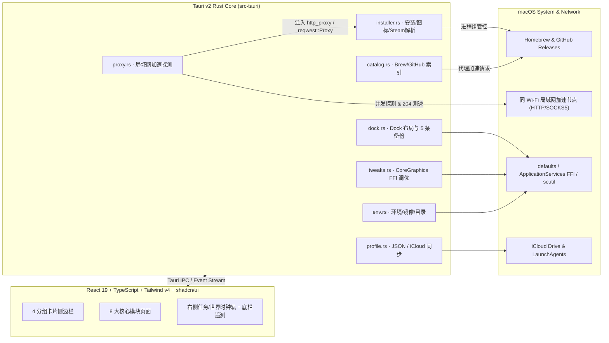

<div align="center">
  

  <h1>Star Box</h1>

  <p>
    <strong>面向 Mac 用户的零命令行门槛软件中心、新机开荒助手与系统调优工具</strong>
  </p>

  <p>
    <a href="https://github.com/starandget/star-box/releases/latest">
      
    </a>
    <a href="https://github.com/starandget/star-box/actions/workflows/release.yml">
      
    </a>
    <a href="https://github.com/starandget/star-box/releases/latest">
      
    </a>
    <a href="https://v2.tauri.app/">
      
    </a>
    <a href="https://www.rust-lang.org/">
      
    </a>
    <a href="https://github.com/starandget/star-box/blob/main/LICENSE">
      
    </a>
  </p>

  <p>
    <a href="#-为什么选择-star-box">设计初衷</a> ·
    <a href="#-核心功能矩阵">核心功能</a> ·
    <a href="#-下载与安装">下载安装</a> ·
    <a href="#-系统架构">系统架构</a> ·
    <a href="#-本地开发与构建">源码构建</a> ·
    <a href="#-常见问题-faq">常见问题</a> ·
    <a href="https://starandget.github.io/star-box/">官方网站</a>
  </p>
</div>

---

## 💡 为什么选择 Star Box？

换新 Mac 或日常维护软件时，往往要在终端脚本、Homebrew 报错、海外慢速下载、杂乱的 Dock 栏和深藏在「系统设置」里的开关之间反复横跳。**Star Box** 将这些高频痛点收敛进一个仅 **~5 MB** 的原生桌面应用中：

| 传统 Mac 装机与日常维护痛点 | Star Box 解决方案 |
| :--- | :--- |
| **Homebrew 安装门槛高**：需手动装 Xcode CLT、配环境变量、找国内镜像源 | **一键静默引导**：自动通过 `softwareupdate` 装好 CLT，一键切换清华/中科大/阿里源并自动写入 `~/.zprofile` & `~/.zshrc` |
| **开源软件下载慢**：GitHub Release 或 Cask 官方源直连较慢甚至中断 | **局域网加速自动发现**：同 Wi-Fi / 局域网设备开启端口共享后，一键发现可用加速节点并测速，**仅加速下载不改系统全局网络** |
| **软件来源分散**：有的在 Brew，有的在 GitHub Releases，有的在 Steam | **五大软件源 + 本地优先扫描**：聚合银河系/河外星系/星盒私藏/14,000+ Brew/GitHub 直装；自动穿透 Steam 快捷方式壳子识别真实 `.app` 本体 |
| **Dock 整理繁琐**：手动拖几十个图标，脚本写入又会让 Safari 带替身小箭头 | **无名横条拖拽 + 软链接解析**：第 1 组锁定 9 个核心系统应用（自动 `canonicalize` 去小箭头），直接拖拽图标分组调序，组间自动插空白分隔符，支持 5 条历史备份回滚 |
| **外接鼠标滚轮反人类**：每次接鼠标都要进系统设置翻找「自然滚动」开关 | **CoreGraphics FFI 0 延迟反转**：在「快捷设置」里点一下即刻全局反转滚轮方向（无需注销），并集成 Finder 增强与系统面板直达 |

---

## ✨ 核心功能矩阵

Star Box 左侧导航采用 **4 大卡片槽分组 · 8 大功能模块**，右侧配备实时任务抽屉与菜单栏世界时钟，底部状态栏实时汇总环境遥测信息：

| 分组 | 模块 | 核心能力 | 技术亮点 |
| :---: | :---: | :--- | :--- |
| **环境与网络** | **本机环境** | 芯片架构 / Xcode CLT / Homebrew 检测与安装、国内镜像源切换、`~/Documents/<目录>/default` 工作目录初始化 | 进程组级（`process_group` + `killpg`）随时安全终止安装任务 |
| **环境与网络** | **局域网加速** | 动态枚举活跃局域网网卡、ARP 存活设备、本机端口与 `scutil --proxy` 系统通道；支持手动填写 `HTTP` / `SOCKS5` | 单 Socket UDP ARP 预热 + 安全并发端口探测 + 真实 204 连通性毫秒级测速 |
| **软件管理** | **浏览软件** | `银河系 (21)` · `河外星系 (38)` · `Homebrew (14,000+)` · `GitHub 直装` · `星盒私藏 (18)`，按 **9 大统一分类**归档 | GitHub Releases 自动匹配 `arm64` / `x86_64` 资产，挂载安装后自动移除 `com.apple.quarantine` |
| **软件管理** | **我的软件** | 「本机已装」自动扫描 `/Applications` 与 `~/Applications`；「待安装」管理装机清单 | `sips` 提取原生 `.icns` 高清图标（带路径 FNV-1a 哈希缓存），自动解析 Steam `run.sh` 壳子至 `steamapps/common` 本体 |
| **软件管理** | **任务队列** | 安装 / 更新 / 卸载任务流式日志查看、单任务终止、全部终止、失败重试与官网直达 | 独立 `TaskControl` + `AtomicBool` 取消令牌，实时中断子进程树与 HTTP 流 |
| **桌面整理** | **Dock 整理** | 第 1 组锁定 9 大系统应用；本机应用按无名紧凑横条分组，支持图标拖拽排序、跨组移动、移入「暂不放入区」、空组自动清理 | 自动导出 `com.apple.dock` `.plist` 备份（自动裁剪保留最近 5 条），组间注入 `small-spacer-tile` |
| **系统** | **快捷设置** | **鼠标与键盘**（滚轮正逆向、长按连续输入）、**访达与文件**（隐藏文件、扩展名、路径栏、禁 `.DS_Store`）、**Dock 与截图**（零延迟自动隐藏、去窗口黑影）、**系统直达**（7 大面板） | Rust FFI 直接调用 `ApplicationServices` 的 `CGSSetSwipeScrollDirection` 实现 0 延迟滚轮反转 |
| **系统** | **设置** | 登录 Mac 自动启动（`LaunchAgents`）、在线检查更新、**浅色 / 暖白 / 深色**三主题切换、JSON 导入导出与 **iCloud Drive** 同步 | 原生对接 `~/Library/Mobile Documents/com~apple~CloudDocs/StarBox` |

> [!TIP]
> **自适应 Dock 对齐窗口**：Star Box 启动时会自动读取当前屏幕工作区高度与底部 macOS Dock 的实际横向跨度，使窗口高度自然铺满顶栏至 Dock 之间、左右边缘与 Dock 精准对齐。

---

## 📦 下载与安装

### 1. 下载安装包

前往 [**GitHub Releases**](https://github.com/starandget/star-box/releases/latest) 下载对应你 Mac 芯片架构的安装包：

| Mac 芯片类型 | 适用机型 | 推荐下载文件 |
| :--- | :--- | :--- |
| **Apple Silicon (`arm64`)** | M1 / M2 / M3 / M4 全系列 Mac | `Star.Box_x.x.x_aarch64.dmg` |
| **Intel (`x86_64`)** | 2020 年及更早的 Intel 芯片 Mac | `Star.Box_x.x.x_x64.dmg` |

双击打开 `.dmg` 后，将 **Star Box.app** 拖入 `Applications`（应用程序）文件夹即可。

### 2. 首次打开绕过 macOS Gatekeeper 提示

> [!IMPORTANT]
> 由于开源版本暂未使付费 Apple Developer ID 签名公证，首次打开若弹出 **「“Star Box”已损坏，无法打开」** 或 **「无法验证开发者」**，请在「终端（Terminal）」执行以下一行命令移除隔离属性，之后即可正常打开：

```bash
xattr -cr "/Applications/Star Box.app"
```

---

## 🏗️ 系统架构



---

## 🛠️ 本地开发与构建

### 环境要求

- **操作系统**：macOS 12.0 Monterey 及以上
- **Node.js**：`>= 20`（推荐使用 `pnpm` 包管理器）
- **Rust**：`stable` 工具链（通过 `rustup` 安装）及 Xcode Command Line Tools

### 快速启动

```bash
# 1. 克隆仓库
git clone https://github.com/starandget/star-box.git
cd star-box

# 2. 安装前端依赖
pnpm install

# 3. 启动 Tauri 桌面开发模式（支持前端 Vite HMR 与 Rust 自动重编）
pnpm tauri dev
```

### 生产构建

```bash
# 仅检查前端 TypeScript 类型与 Vite 打包
pnpm build

# 检查 Rust 后端代码
cargo check --manifest-path src-tauri/Cargo.toml

# 打包 macOS 正式版 .app 与 .dmg 安装包（输出至 src-tauri/target/release/bundle/）
pnpm tauri build
```

### 目录结构

```text
star-box/
├── .github/workflows/
│   ├── release.yml                # Tag 触发的双架构 (arm64 + x64) macOS 自动打包与发版流水线
│   └── pages.yml                  # GitHub Pages 官网自动部署流水线
├── catalog/
│   └── featured.json              # 59 款精选 Mac 软件目录（银河系 21 + 河外星系 38，9 大统一分类）
├── docs/
│   └── index.html                 # GitHub Pages 在线展示主页
├── src/                           # React 19 + TypeScript + Tailwind CSS v4 前端
│   ├── components/
│   │   ├── ui/                    # shadcn/ui 基础组件与分组 Sidebar 原语
│   │   ├── Sidebar.tsx            # 4 分组内嵌卡片槽左侧导航栏
│   │   ├── RightToolRail.tsx      # 右侧快捷工具轨（下载任务 + 世界时钟抽屉）
│   │   ├── StatusBar.tsx          # 底部全宽环境遥测状态栏
│   │   └── TrayClockPopover.tsx   # macOS 菜单栏世界时钟浮窗
│   ├── lib/
│   │   ├── appGroups.ts           # 9 大统一软件分类与本地应用智能归类引擎
│   │   └── starVault.ts           # 「星盒私藏」18 款装机必备清单定义
│   └── pages/                     # 8 大核心模块页面
│       ├── EnvPrepPage.tsx        # 本机环境（检测、Homebrew 安装、镜像源、工作目录）
│       ├── ProxyPage.tsx          # 局域网加速（局域网节点自动发现、测速、独立下载通道）
│       ├── DiscoverPage.tsx       # 浏览软件（银河系/河外星系/Homebrew/GitHub/星盒私藏）
│       ├── MyAppsPage.tsx         # 我的软件（本机已装扫描 + 待安装清单）
│       ├── QueuePage.tsx          # 任务队列（流式日志 + 进程组级取消）
│       ├── DockPage.tsx           # Dock 整理（固定首组、无名横条拖拽、5 条备份回滚）
│       ├── QuickTweaksPage.tsx    # 快捷设置（0 延迟滚轮切换、Finder/Dock 调优、系统面板直达）
│       └── SettingsPage.tsx       # 设置（开机自启、版本更新、三套主题、iCloud 同步）
└── src-tauri/                     # Tauri v2 + Rust 后端
    └── src/
        ├── commands/              # env / proxy / catalog / installer / dock / tweaks / profile
        ├── models.rs              # 前后端共享数据结构
        └── lib.rs                 # 窗口 Dock 对齐几何、菜单栏托盘与命令注册
```

---

## ❓ 常见问题 (FAQ)

<details>
<summary><strong>Q1：启用「局域网加速」后，会影响我 Mac 上浏览器或其他软件的网络吗？</strong></summary>
<br/>
不会。Star Box 的加速通道是<strong>应用内隔离</strong>的——它只作用于 Star Box 自身发起的 <code>brew</code> 子进程和 GitHub 下载请求，不会修改 macOS 的全局系统网络设置。
</details>

<details>
<summary><strong>Q2：局域网设备已开启加速服务，为什么点「自动发现局域网加速」没扫出来？</strong></summary>
<br/>
请确认两点：<br/>
1. 加速设备和 Mac 连接在<strong>同一个 Wi-Fi / 局域网</strong>下（且路由器未开启 AP 隔离）；<br/>
2. 对应网络工具内已打开<strong>「允许局域网连接」</strong>（默认扫描常见端口：<code>1082</code> / <code>7890</code> / <code>7897</code> / <code>6152</code> / <code>8888</code> / <code>8889</code> / <code>10809</code>）。若使用了自定义端口，可在页面下方直接手动输入 <code>IP:端口</code> 测试并启用。
</details>

<details>
<summary><strong>Q3：「Dock 整理」点击一键应用后，如果不喜欢怎么恢复原来的 Dock？</strong></summary>
<br/>
每次点击「一键应用」前，Star Box 都会自动将你当前的 Dock 完整导出为 <code>.plist</code> 备份（保存在 <code>~/Library/Application Support/com.starandget.starbox/dock-backups/</code>，最多保留最近 5 条）。在「Dock 整理」页面底部点击任意一条备份右侧的<strong>「恢复此备份」</strong>即可一秒还原。
</details>

---

## 🤝 参与贡献

欢迎通过 [Issues](https://github.com/starandget/star-box/issues) 反馈 Bug 或提出新软件收录建议，也欢迎提交 Pull Request：

1. Fork 本仓库并创建特性分支（`git checkout -b feat/your-feature`）
2. 确保前端与 Rust 均无编译警告（`pnpm build && cargo check --manifest-path src-tauri/Cargo.toml`）
3. 提交遵循 Conventional Commits 规范的 Commit 并礼貌发起 PR

---

## 📄 开源协议

本项目基于 [**MIT License**](https://github.com/starandget/star-box/blob/main/LICENSE) 开源，免费供个人与商业使用。
